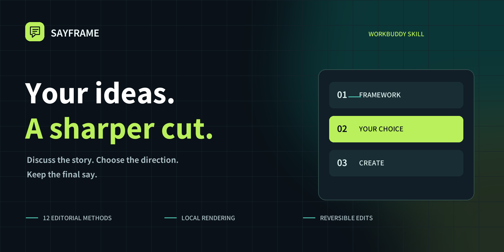
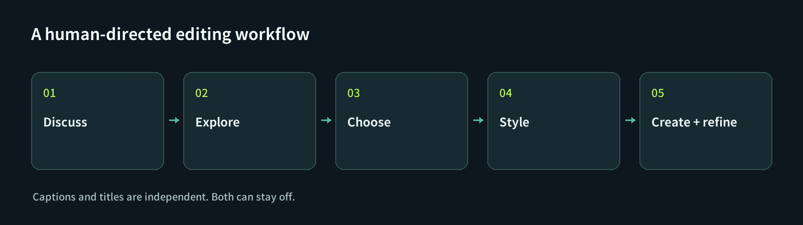

<p align="center"></p>

<p align="center"><strong>English</strong> · <a href="README.zh-CN.md">简体中文</a></p>
<p align="center">
  
  
  
  
</p>

<h1 align="center">An editing partner for what you have to say.</h1>
<p align="center">Turn expert interviews and talking-head recordings into focused short videos.<br>Discuss the idea. Pick a direction. Edit in natural language.</p>

SAYFRAME is an open-source **WorkBuddy skill with a local editing workbench**.
It brings twelve editorial methods to the conversation, then turns your approved
direction into an editable, source-bound cut. Your WorkBuddy model handles content
reasoning; local tools handle speech alignment and video rendering.

**You choose the direction. You choose whether captions and on-screen titles appear.**

## Start with a conversation

> “Here is my interview. Who is it useful for? Recommend a few frameworks and
> editing directions first. Don't edit yet.”

SAYFRAME explains what each cut is about, why a framework fits, which original
quotes support it, and what is missing. Once you confirm a direction, it asks
two separate questions: **add captions? add a title?** Both can be off.



> “Let's use direction two. Captions on, title off. Keep the short question that
> makes the answer understandable.”
>
> “The example is too long. Tighten it, but keep the condition. Undo the last change.”

## What makes it different

| Capability | What you get |
| --- | --- |
| **A framework before a timeline** | Audience, hook, reasoning, credibility and ending are discussed before a cut is made. |
| **Twelve editorial methods** | Danjie adaptations for audience selection, openings, evidence, expertise, stories and multiple angles. These are editing adaptations, not twelve separate card-making applications. |
| **Your final say** | Direction confirmation and independent caption/title choices are required for newly imported projects. |
| **Edits you can revisit** | Source recordings stay untouched. Restore sentences, reorder the transcript and keep persistent undo/redo. |
| **A real local workbench** | Inspect plans, drag whole sentences, adjust voice/music levels and preview the same movie you download. |
| **Source-aware safety checks** | Original-quote references, stale-draft protection, acoustic boundary checks and compiled-audio integrity checks. |
| **Optional cover workflow** | A bundled anonymous style reference, confirmed wording, three layout choices and a selected cover merged into the first frame. Native image generation is optional. |

### Four ways to finish

| | Title off | Title on |
| --- | --- | --- |
| **Captions off** | Clean picture | Title only |
| **Captions on** | Captions only | Captions + title |

Turning text off changes the rendering, not the spoken content or clip order.
Existing projects retain their previous appearance until you change it.

## Install in WorkBuddy

Copy this request into **Windows WorkBuddy**:

```text
Install SAYFRAME from https://github.com/msaysay/sayframe.
Read SKILL.md and install its manifest-listed skill files into my WorkBuddy
skills directory. Explain any first-time dependency/model downloads before
running setup. Then help me discuss frameworks and editing directions first.
Do not render until I confirm a direction and choose captions and title options.
```

This is a natural-language installation request, not a claim that every WorkBuddy
version has a dedicated “install URL” field. If your version cannot import a
repository URL, use the ZIP route below.

**ZIP:** download `SAYFRAME-WorkBuddy-0.4.0.zip` from
[Releases](https://github.com/msaysay/sayframe/releases), then open
**Experts · Skills · Connectors → Skills → Add skill → Upload skill** in WorkBuddy.
Menu labels may vary by version. See the
[official skills guide](https://www.codebuddy.cn/docs/workbuddy/From-Beginner-to-Expert-Guide/Function-Description/Skills-Market).

**From source:** clone this repository and run `python scripts/install.py`.
The installer verifies the file manifest and preserves an existing private runtime.

### First-run requirements

- Windows is the tested target; Python **3.11 or 3.12** is required.
- First use downloads Python dependencies, FFmpeg and a speech-alignment model;
  allow time, network access and several GB of free space for media and caches.
- WorkBuddy's native `AudioTranscribe` is preferred when available. Large video
  files are converted to smaller audio parts automatically. Local SenseVoice is
  the fallback; Whisper is optional.
- No author's API key or server is needed. WorkBuddy models and native tools still
  follow **your account's usage limits and billing**. This is not a zero-credit promise.

See [installation details](docs/INSTALL.md) and [the skill entrypoint](SKILL.md).

## Privacy, without the fine-print surprise

The repository contains code, methodology adaptations, openly licensed fonts and
an anonymous cover reference. **No private recordings, client projects, account
tokens or API keys are included.**

Rendering and acoustic alignment run locally. If you use WorkBuddy's native
transcription, image tools or conversational model, relevant content is processed
by that provider; SAYFRAME does not claim a completely offline cloud workflow.
Your recordings are not uploaded to a SAYFRAME-operated server.

## Current boundaries

This is a **preview**, not a promise of flawless one-click cleanup.

- Whole-sentence selection and reordering work. **Complete word-level audio deletion
  is not yet ported to this skill**; fillers and restarts can remain. Subtitle edits
  never count as deleting audio.
- Caption display timing is estimated; it is not certified phoneme timing.
- Acoustic checks can block a cut rather than risk losing a normal neighboring word.
- Multi-recording composition, picture-in-picture editing and the full desktop
  font/music library are not included.
- The workbench UI currently uses Chinese. This repository's documentation is
  available in English and Simplified Chinese; that is not a claim of fully localized UI.
- Earlier builds were exercised on three real interviews, including actual movie
  playback and downloads. Current regression tests include rendering and workflow
  gates; they do not prove perfect semantics, hearing or a clean-machine install.

## Built to be inspected

```text
SKILL.md              Host workflow and permission boundaries
references/           Editorial methods and typed edit contracts
engine/               Source-bound edits, plans, rendering and local workbench
engine/shared/        Shared editorial/acoustic implementation
scripts/              Setup, manifest-checked install and release packaging
tests/                Contract and media regressions
assets/               Brand mark, open fonts and anonymous cover reference
```

For development: prepare the local runtime with `python scripts/setup.py`, then
run `runtime/python/Scripts/python.exe -m unittest discover -s tests -v`.
Build the installable ZIP with `python scripts/build_release.py`.

Contributions that improve real cut quality, source fidelity, installation and
clear human choices are welcome. See [Contributing](CONTRIBUTING.md).

## Credits & license

Code: [MIT](LICENSE). Fonts and runtime dependencies retain their own licenses;
see [third-party notices](THIRD_PARTY_NOTICES.md). The editorial catalog adapts the
Danjie methodologies co-developed by the project authors and Dandan. OpenFilm
inspired the project-local, reversible editing approach. This community project
is not affiliated with or endorsed by Tencent WorkBuddy.
