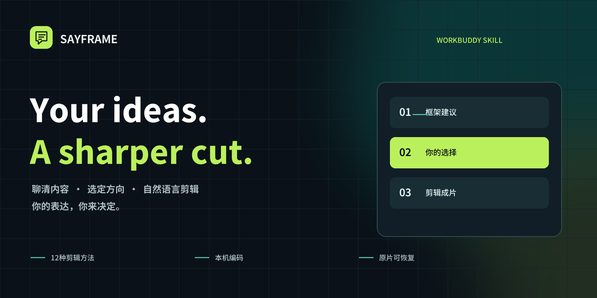
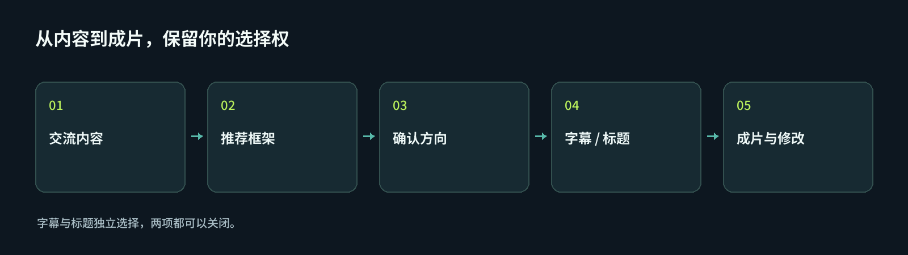

<p align="center"></p>
<p align="center"><a href="README.md">English</a> · <strong>简体中文</strong></p>
<p align="center">  </p>

<h1 align="center">让有内容的人，把话剪得更有力量。</h1>
<p align="center">先聊清楚讲什么，再确定怎么剪。<br>用自然语言，把访谈和专家口播变成有主线的短视频。</p>

SAYFRAME 是一个开源的 **WorkBuddy 剪辑技能 + 本机可视化工作台**。
它把十二种剪辑方法带进对话，让你先选方向，再生成成片，随后继续用自然语言修改。
WorkBuddy 模型理解内容，本机组件负责声音定位与视频编码。

**方向由你确认，字幕和标题由你选择，两项都可以不加。**

## 从一段对话开始

> “这是我的访谈。先帮我看看适合谁看，推荐几个框架和剪辑方向，先别剪。”

工具会说明每条讲什么、为什么适合这个框架、有哪些原话支撑、还缺什么。
你确认方向后，再分别选是否加自动字幕、是否加画面标题，不替你默认。



> “就第二条吧，只加字幕，不加上面的标题，必要的短提问留一句。”
>
> “案例太长了，收紧一点，条件别剪没。刚才那步撤销。”

## 它适合怎样的剪辑

| 能力 | 实际做什么 |
| --- | --- |
| **先有框架，再进时间线** | 先讨论观众、开场、论证、实力依据与结尾，再按原片选句。 |
| **十二方法剪辑适配** | 内置蛋解目标客户、选题、开场、支撑、绝活、故事及一题多讲等方法；不是十二个原制卡应用的完整迁移。 |
| **保留选择权** | 新导入素材必须先确认方向，再分别选字幕和标题。 |
| **可以退回的修改** | 原视频不动，可恢复整句、拖动调序、跨会话撤销重做。 |
| **本机工作台** | 看方案、改文稿、调人声音量和自备配乐；预览与下载使用同一个视频。 |
| **原话与声音保护** | 绑定原句，拒绝过期修改；切口不确定时阻止导出，不冒险切掉正常字。 |
| **可选封面** | 默认匿名参考图，确认文字后出三版排版，选定后合成首帧；也可调用宿主原生生图做装饰。 |

### 四种画面，由你决定

| | 不加标题 | 添加标题 |
| --- | --- | --- |
| **不加字幕** | 干净画面 | 仅标题 |
| **添加字幕** | 仅字幕 | 字幕 + 标题 |

关闭文字只影响画面渲染，不改声音和取音顺序。旧工程保留原来的显示设置，直到你主动修改。

## 安装到 WorkBuddy

在 **Windows WorkBuddy** 里粘贴：

```text
帮我安装 https://github.com/msaysay/sayframe 里的 SAYFRAME 技能。
先阅读 SKILL.md，按 manifest 安装技能文件；首次下载依赖和模型前先说明。
安装后先跟我交流内容，推荐框架和剪辑方向。
等我确认方向、选择字幕和标题是否添加，再生成成片。
```

这是自然语言安装请求，不表示所有版本都有专门的“GitHub地址安装”输入框。
如果当前版本不能按仓库地址安装，请到 [Releases](https://github.com/msaysay/sayframe/releases)
下载 `SAYFRAME-WorkBuddy-0.4.0.zip`，在“专家·技能·连接器 → 技能 → 添加技能 → 上传技能”导入。
菜单名称以你的版本为准，参阅 [WorkBuddy 官方技能说明](https://www.codebuddy.cn/docs/workbuddy/From-Beginner-to-Expert-Guide/Function-Description/Skills-Market)。

源码安装：克隆本仓库后运行 `python scripts/install.py`，安装器校验白名单文件，保留已有私密 runtime。
详见[安装说明](docs/INSTALL.zh-CN.md)。

### 首次运行

- 测试目标为 Windows，需要 Python **3.11 或 3.12**。
- 首次联网下载依赖、FFmpeg 和声音定位模型，媒体和缓存需要数 GB 可用空间。
- 有 WorkBuddy 原生 `AudioTranscribe` 时优先用它；大视频先自动提取压缩音轨。缺少时回退本地 SenseVoice，Whisper 可选。
- 不需要作者的 API Key 或服务器。**WorkBuddy 模型、转写和生图仍按学员自己的账户规则计费**，不承诺零积分。

## 私人素材不进开源包

仓库只有代码、方法论适配、开放字体和匿名封面参考图，**不含私人原片、客户工程、账号登录或 API Key**。

声音定位和编码在本机；使用 WorkBuddy 的对话、原生转写或生图时，相关内容仍会由对应服务处理，不能称整个云端流程完全离线。素材不上传到 SAYFRAME 作者运营的服务器。

## 当前边界，请先了解

这是 **预览版**，不是所有口吃都能一键去净的承诺。

- 支持完整句组取舍和调序；**完整逐字删音还没有迁入学员版**，语气词和重说可能保留。改字幕不算删声音。
- 字幕显示时间为估计，不是逐音素对齐认证。
- 声音检查可能阻止不安全的切点；不为了出片放宽正常字保护。
- 尚未包含跨原片编排、画中画和桌面版完整字体、音乐库。
- 工作台当前以中文显示；本仓库文档提供中英文，不假称应用已经完整多语言化。
- 之前版本已用三条真实访谈实际生成、播放、下载；当前回归覆盖渲染和确认流程，不等于所有语义、听感或全新电脑安装都验收通过。

## 可读、可改、可接续

`SKILL.md` 是宿主入口；`references/` 放方法与修改协议；`engine/` 负责工程、声音检查、编码与工作台；`scripts/` 负责准备环境、安装与打包；`tests/` 保存回归。

开发时先运行 `python scripts/setup.py`，再运行
`runtime/python/Scripts/python.exe -m unittest discover -s tests -v`。
打包使用 `python scripts/build_release.py`。欢迎改进真实切口质量、原话保护、安装和用户选择权，见[贡献说明](CONTRIBUTING.md)。

## 致谢与许可

代码采用 [MIT](LICENSE)。字体、模型和编码组件保留各自许可，见[第三方说明](THIRD_PARTY_NOTICES.md)。
方法目录来自项目作者与蛋蛋共同研发的蛋解方法剪辑适配。OpenFilm 启发了本地工程、可撤销命令等设计。
这是社区项目，与腾讯 WorkBuddy 无官方隶属或背书关系。
